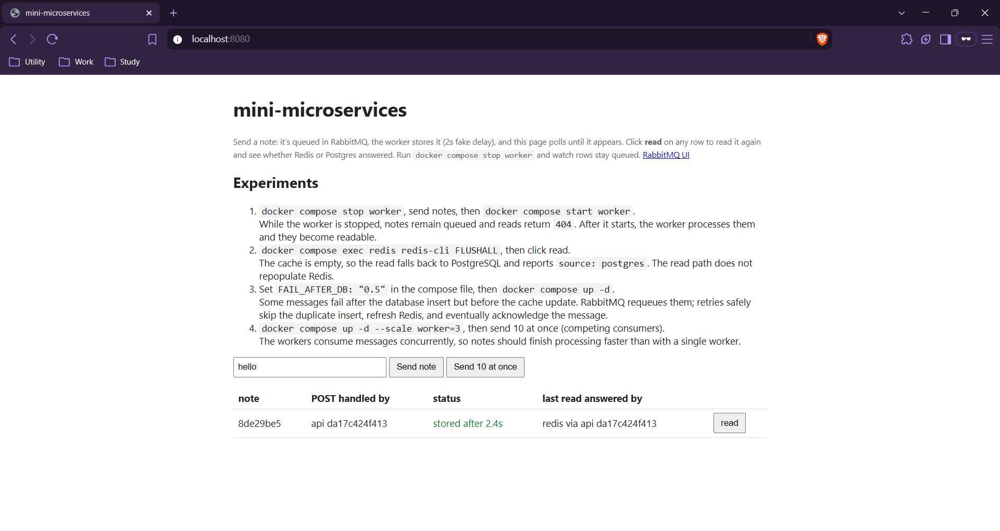

# mini-microservices



A small, runnable example of an asynchronous write pipeline and a cache-backed read path. It combines an HTTP API, a message broker, a background worker, PostgreSQL as the source of truth, and Redis as a disposable read cache. The project is intended to make service boundaries, eventual consistency, retries, and load balancing easy to observe.

Start the system with Docker Compose:

```sh
docker compose up --build
```

Open [http://localhost:8080](http://localhost:8080) to use the UI. Docker with Compose is the only prerequisite.

## Architecture

```text
 Browser
    |
    v
+---------+  serves static UI   +----------+
|  nginx  |-------------------->| Static UI|
| :8080   |                     +----------+
+----+----+
     | API requests
     v
+--------------+
| API replicas |
+--+--------+--+
   |      |
   |      +-- GET lookup ----------> Redis
   |      +-- GET cache miss -------> PostgreSQL
   |
   +-- POST command --> RabbitMQ --> Worker
                                      |  \
                         DB insert/read  cache update
                                      |      \
                                      v       v
                                 PostgreSQL  Redis
```

The worker reads the stored row back from PostgreSQL before updating Redis. It acknowledges the RabbitMQ message only after both writes succeed.

## How it works

- **Write —** `POST /notes` generates a UUID, publishes a persistent command to RabbitMQ, and returns `202 Accepted` with status `queued`; the API does not store the note itself.
- **Worker —** A worker processes one unacknowledged message at a time, inserts the note into PostgreSQL idempotently, reads it back, updates Redis, and acknowledges the message only after both writes succeed. Failures are requeued for retry.
- **Read —** `GET /notes/{id}` checks Redis first, then PostgreSQL on a cache miss. It returns `404` if neither has the note, which can happen while the write is still queued; this read path does not populate the cache.
- **Consistency —** PostgreSQL is authoritative and Redis is disposable. The API-generated ID and conflict-safe insert make redelivery safe; the worker refreshes Redis from the stored database row.
- **UI —** The page polls for a newly submitted note until it is readable, then shows which store answered a read and which API instance handled each request.
- **Routing —** nginx serves the static UI and proxies API requests across the API replicas; `served_by` in API responses makes the selected instance visible.

## Experiments

1. `docker compose stop worker`, send notes, then `docker compose start worker`.  
   While the worker is stopped, notes remain queued and reads return `404`. After it starts, the worker processes them and they become readable.
2. `docker compose exec redis redis-cli FLUSHALL`, then click read.  
   The cache is empty, so the read falls back to PostgreSQL and reports `source: postgres`. The read path does not repopulate Redis.
3. Set `FAIL\_AFTER\_DB: "0.5"` in the compose file, then `docker compose up -d`.  
   Some messages fail after the database insert but before the cache update. RabbitMQ requeues them; retries safely skip the duplicate insert, refresh Redis, and eventually acknowledge the message.
4. `docker compose up -d --scale worker=3`, then Send 10 at once (competing consumers).  
   The workers consume messages concurrently, so notes should finish processing faster than with a single worker.
